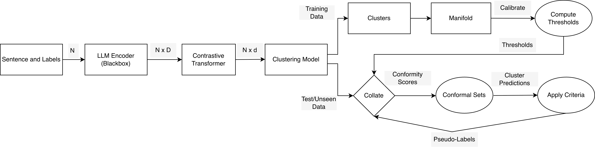

# Contrastive SenseDiscriminator (ContraSD) 

## Overview

This is the central repository for material related to the ContraSD project. The project aims to leverage a conformal calibration methodology for assigning pseudo-labels to sentences from unseen text.

## Pipeline


## Library Dependencies
To run the Notebook scripts for analysis, the scripts to build the Docker containers with library requirements can be found under the [containers subdirectory](containers/).

The library dependencies are listed in the file containers/requirements.txt. 
```
pip install -r containers/requirements.txt
```

## Usage

### Data
Processed data are under the [data subdirectory](data/). As generating embeddings using the pre-trained models can be time consuming, we provide PARQUET formatted files with embeddings created using SBERT (sentence-transformers/all-MiniLM-L6-v2) and Qwen3 (Qwen/Qwen3-8B) models from HuggingFace. These embeddings can be loaded in Milvus database to run the project scripts.
```
## Start the Milvus db instance. Config scripts are in the containers/ directory.
cd src/util
python import_milvus_collections.py
```

### Model Training
Methods for training the model are provided in a [training script](src/model/training.py). Contrastive training uses embeddings generated by a pre-trained encoder. Steps to perform training are as follows:
1. Prompt a pre-trained encoder to generate embeddings: [LLM Prompts script](src/util/llm_prompts.py)
2. Save the embeddings in Milvus (or similar) vector database: [Milvus script](src/util/vector_db.py)
3. Train the contrastive model

### Evaluation
To evaluate the trained model with synthetic data and ETHICS dataset, follow the [evaluation](src/evaluations.ipynb) notebook. Pre-trained model embeddings are required for evaluating with ETHICS dataset.

## Repository Map

```
/
├── containers/                 # Scripts to setup a local environment using Docker for running the code.
│   ├── .env
│   ├── *.yml                   # Container configurations
│   ├── jupyter.dockerfile      # Jupyter container
│   └── requirements.txt        # Library dependencies
├── data/                       # Shared project data
├── src/                        # Contains source code for defining, and training the models.
│   ├── experiments             # Helper classes for experimental evaluation
│   ├── model                   # Model and dataset class definitions
│   └── util                    # Utility classes
├── senses_autoencoder.ipynb    # ContraSD algorithm and training
├── evaluations.ipynb           # Code to perform experimental evaluations
└── README.md                   # This file
```

